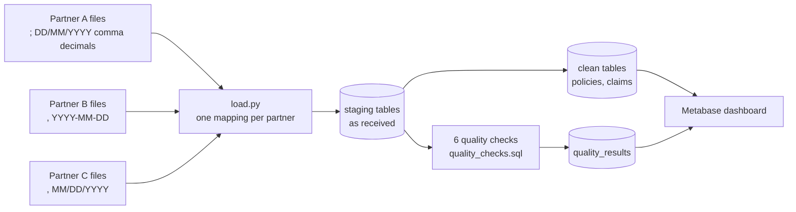

# Insurance partner data quality and reporting

Three insurance distribution partners send policy and claims files, each in its own format. This project maps them to one schema in PostgreSQL, runs six data quality checks, stores the results per run, and feeds a Metabase dashboard for the partner programme.

Portfolio project on simulated data (fixed seed, so every number below can be reproduced).



## What it does

- `src/generate_data.py` creates 1,000 policies and 300 claims for partners A, B and C, each with its own column names, separator, date format and decimal format, plus about 5% deliberate errors.
- `src/load.py` applies one mapping per partner (`src/mappings.py`), converts dates and amounts, and loads everything into staging tables exactly as received. Clean tables keep only the rows that pass every rule.
- `sql/quality_checks.sql` runs six checks per partner. `src/run_checks.py` stores the counts in `quality_results` with the run date and writes `reports/quality_report.md`.
- `sql/dashboard_queries.sql` holds the four dashboard cards.

## The six checks and today's results

| Check | A | B | C |
|---|---|---|---|
| 1. Missing required fields | 3 | 8 | 5 |
| 2. Invalid dates | 6 | 3 | 1 |
| 3. Duplicate policy ids | 2 | 2 | 4 |
| 4. Claims without a matching policy | 3 | 2 | 0 |
| 5. Negative or zero amounts | 9 | 2 | 2 |
| 6. Claim dated before the policy start | 4 | 6 | 2 |

Out of 1,000 policies received, 957 pass every rule. Out of 300 claims, 276 do.

Loss ratio (claims amount divided by premiums, rejected claims excluded): A 0.58, B 0.56, C 0.61.

## Dashboard (Metabase)

Four cards: policies sold per partner per month, claims count and amount per partner, loss ratio per partner, and rejected records per partner and per check. Setup steps are in [docs/metabase_dashboard.md](docs/metabase_dashboard.md).

## How to run

```bash
docker compose up -d                 # PostgreSQL and Metabase
python -m venv .venv
source .venv/bin/activate            # Windows: .venv\Scripts\activate
pip install -r requirements.txt
python -m src.generate_data
python -m src.load
python -m src.run_checks
python -m pytest -q
```

If you also run the partner-data-onboarding-n8n project, stop it first or change the port, because both use 5432.

## Design choices

- **Keep the raw data.** Staging tables keep rows as received, so every check can count real problems and a partner can be shown exactly which rows failed.
- **One mapping per partner.** Adding a partner D is one new entry in `mappings.py`. The loading, the checks and the dashboard don't change.
- **Checks are counted, not just fixed.** Storing results per run and per partner shows whether a partner's data is getting better or worse over time.

## Next steps

- Alert when a check's count jumps compared with the previous run.
- Send each partner a monthly data quality scorecard.
- Move the checks into dbt tests once the number of partners grows.

## Stack

Python (pandas), SQL, PostgreSQL, Metabase, Docker Compose, pytest, GitHub Actions

## Author

Saiteja Eleti
